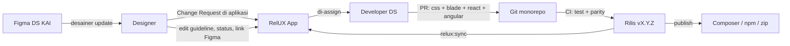

# PRD: RelUX Design System App
**Dokumen kebutuhan produk untuk aplikasi web internal design system KAI**

| | |
|---|---|
| **Nama Produk** | RelUX Design System App |
| **Domain** | relux.kai.id / design.kai.id |
| **Owner** | UI/UX Lead — IT Application Development, PT KAI |
| **Target Pengguna** | Tim UI/UX Designer & Tim Developer internal KAI |
| **Referensi** | untitledui.com/react, untitledui.com/react/components |
| **Status** | Draft v2 (menggantikan prototipe RawUI) |

---

## 1. Latar Belakang & Masalah

Tim desain sudah mengimplementasikan design system RelUX (berbasis Untitled UI Kit) di Figma — file **Design System KAI v.1**. Namun hasil aplikasi yang dibangun developer sering **tidak 1:1** dengan desain, karena:

1. Developer menerjemahkan desain Figma secara manual (interpretasi ulang, bukan kode siap pakai)
2. Struktur/skeleton komponen tidak konsisten antar developer dan antar project
3. KAI memakai tiga stack frontend — **Laravel/Livewire, React, Angular** — dan belum ada kode komponen resmi untuk ketiganya
4. Tidak ada dokumentasi aturan pakai (usage guideline) yang terpusat
5. Tidak ada alur resmi ketika desain di Figma berubah (siapa meng-update kode, kapan dirilis)

Akibatnya muncul *design debt*: UI menyimpang dari desain resmi dan sulit di-maintain karena tiap project punya versi komponennya sendiri.

## 2. Tujuan Produk

- **Single source of truth** komponen RelUX dalam bentuk kode siap pakai untuk Blade/Livewire, React, dan Angular — tampilan identik karena memakai CSS dan token yang sama
- Pengalaman dokumentasi setara Untitled UI React: preview langsung, kode yang bisa di-copy, instalasi via CLI, dan download
- Distribusi resmi melalui package internal (Composer + npm) dan zip
- Alur kerja Figma → kode yang tercatat (change request, review, rilis, changelog)
- Membantu developer (dan AI coding assistant yang mereka pakai) menghasilkan UI yang sesuai design system

## 3. Target Pengguna & Peran

| Persona | Kebutuhan Utama | Role di aplikasi |
|---|---|---|
| **Developer (Laravel/Livewire, React, Angular)** | Kode komponen siap pakai di framework masing-masing, cara instalasi, download | Viewer (atau tanpa login) |
| **UI/UX Designer** | Menulis usage guideline, link Figma, mengajukan perubahan komponen | Editor |
| **Design System Lead / Tech Lead** | Menyetujui konten, mengelola rilis, mengelola role, audit kepatuhan | Maintainer |
| **Product Owner / Manajer Tim** | Melihat cakupan (coverage) design system dan status perubahan | Viewer |

Hak akses:

| Aksi | Tanpa login | Viewer | Editor | Maintainer |
|---|:-:|:-:|:-:|:-:|
| Membaca dokumentasi, copy kode, download | ✓ | ✓ | ✓ | ✓ |
| Mengedit konten dokumentasi komponen (jadi revisi *pending*) | | | ✓ | ✓ |
| Mengajukan change request | | | ✓ | ✓ |
| Menyetujui/menolak revisi konten | | | | ✓ |
| Mengelola change request, rilis, dan role pengguna | | | | ✓ |

> Akses baca & download terbuka di jaringan internal KAI; login hanya dibutuhkan untuk area `/manage`.

## 4. Lingkup (Scope)

### 4.1 Termasuk dalam scope (Fase 1 / MVP)
- **Landing page** satu halaman
- **Layout dokumentasi**: sidebar, header dengan breadcrumbs, konten, daftar isi (TOC)
- **Dokumentasi**: Introduction, Installation, Theming, Dark mode, Typography, CLI, Icons, Changelog
- **Foundations**: warna, tipografi, spacing, radius, shadow (design token)
- **10 komponen dasar**: Buttons, Inputs, Badges, Checkboxes, Toggles, Dropdowns, Tooltips, Avatars, Tags, Alerts — masing-masing dalam Blade/Livewire, React, dan Angular
- Copy code, dark mode, theming (brand color), download zip, package Composer & npm
- Pencarian ⌘K, "Copy for AI" + `llms.txt`
- Manajemen konten, change request, dan role (setelah login)
- Login melalui SuperApp KAI (**diimplementasikan paling akhir**)

### 4.2 Fase berikutnya
- **Application UI** dari folder `DS KAI v.1` (Tables, Tabs, Modals, Pagination, Breadcrumbs, Sidebar/Application navigation, Date pickers, Calendars, File upload, Charts, Metrics, Command menus, Empty states, Loading indicators, Progress steps, dll.) — tampil di sidebar dengan status `planned` sejak Fase 1
- **Page examples** (Dashboards, Settings pages, Informational pages, Log in & sign up, 404, Email templates)
- CLI npm (`npx @kai/relux add`) untuk project React/Angular
- Sinkronisasi token otomatis dari Figma

### 4.3 Di luar scope
- Kategori **Marketing** Untitled UI (landing page publik, pricing, blog, dsb.) — aplikasi ini internal
- Edit kode komponen langsung dari browser (kode selalu melalui Git, lihat §7.3)
- Playground custom theme per project yang disimpan di server

> **Sumber konten:** file `DS KAI v.1/*.md` (hasil ekstraksi Figma) menjadi referensi struktur, varian, dan token. File ini tidak berisi kode maupun usage guideline — kode ditulis di repo, guideline ditulis melalui aplikasi.

## 5. Fitur & Functional Requirements

### 5.1 Landing Page
- Satu halaman: logo RelUX/KAI, judul, tagline singkat
- Dua tombol utama: **Components** (→ `/components`) dan **Documentation** (→ `/docs/introduction`)
- Mendukung dark mode

### 5.2 Layout Dokumentasi
Semua halaman selain landing memakai layout yang sama:
- **Sidebar kiri**: grup *Documentation*, *Foundations*, *Base components*, *Application UI*, *Page examples*; item aktif ditandai; komponen `planned` tampil dengan label dan tidak bisa dibuka; di mobile menjadi drawer
- **Header**: breadcrumbs (mis. `Components / Base components / Buttons`), tombol pencarian ⌘K, pemilih brand theme, toggle dark mode, tombol login/akun
- **Konten**: area utama halaman
- **Daftar isi kanan** ("On this page") dari heading halaman, dengan anchor link
- Navigasi sebelumnya/berikutnya di bawah konten

### 5.3 Dokumentasi
| Halaman | Isi |
|---|---|
| Introduction | Apa itu RelUX, prinsip, perbedaan "copy code" vs package, tech stack |
| Installation | Tab **Blade/Livewire · React · Angular**: install package, import CSS/token, setup `relux.js` |
| Theming | Variabel `--relux-color-brand-50…950`, pemilih warna live, export `theme.css` |
| Dark mode | Mekanisme `data-theme`, default mengikuti sistem, contoh toggle per framework |
| Typography | Font Inter & Roboto Mono, skala teks, cara pakai |
| CLI | `php artisan relux:init / relux:add / relux:list` (dan npm CLI di fase berikutnya) |
| Icons | Set ikon yang dipakai dan cara menggunakannya |
| Changelog | Riwayat rilis library (versi, tanggal, komponen yang berubah) |

Konten dokumentasi berupa file Markdown di repo; setiap blok kode punya tombol copy.

### 5.4 Foundations (Design Tokens)
- Halaman warna, tipografi, spacing, radius, shadow
- Setiap token menampilkan: preview (swatch/sampel), **nama di Figma**, **nama CSS variable**, nilai light & dark, tombol copy
- Download `tokens.css` dan `tokens.json` (format W3C Design Tokens)
- Penamaan token wajib sinkron dengan Figma

### 5.5 Halaman Komponen
Mengikuti pola halaman komponen Untitled UI React:
1. Judul, deskripsi, badge status (`stable` / `beta` / `deprecated` / `planned`), versi
2. Link: Figma (node komponen), source code di repo
3. **Contoh utama** dengan tab **Preview / Code**
4. **Installation**: tab *CLI* (`php artisan relux:add button`, `npm i @kai/relux-react`, dsb.) dan *Manual* (salin file)
5. **Contoh per varian** — masing-masing punya Preview/Code. Contoh Button (dari Figma): hierarchy (Primary, Secondary, Tertiary, Link color, Link gray), size (xs–xl), icon leading/trailing/only, loading, disabled, destructive, mode link (`href`)
6. **Props / API** tabel: nama, tipe, default, deskripsi (per framework bila berbeda)
7. **Usage guidelines**: kapan dipakai, kapan tidak, contoh benar/salah (Do / Don't)
8. **Aksesibilitas**: keyboard, ARIA, kontras, ukuran target klik
9. **FAQ**
10. **Riwayat perubahan** komponen (dari rilis)
11. Tombol **Download** (per framework) dan **Copy for AI**

### 5.6 Code, Copy & Framework Switcher
- Tab kode: **Blade/Livewire · React · Angular · CSS**
- Pilihan framework diingat (localStorage) dan berlaku di seluruh halaman
- Syntax highlighting; tombol copy di setiap snippet dengan umpan balik "Copied"
- Snippet valid dan langsung bisa dipakai tanpa modifikasi struktur

### 5.7 Dark Mode & Theming
- Dark mode: default mengikuti `prefers-color-scheme`, toggle manual, disimpan; tanpa kedipan tema saat load
- Theming: pilihan preset brand (default KAI + beberapa preset) atau hex kustom → dibangkitkan skala 50–950
- Perubahan brand langsung terlihat di semua preview
- Export `theme.css` untuk dipakai di project
- Peringatan kontras bila warna brand tidak memenuhi WCAG AA

### 5.8 Download & Package
- **Zip**: satu komponen, beberapa komponen terpilih (bundle), atau seluruh library — per framework. Isi: file framework, CSS komponen, `tokens.css`, `relux.js` (bila perlu), README instalasi
- **Composer**: `kai/relux-ui` — Blade components (`<x-relux::button>`) + perintah Artisan:
  - `relux:init` — publish CSS/JS dan menambahkan include di layout
  - `relux:add {komponen...} --path --overwrite` — menyalin source komponen ke project (project memiliki kodenya, seperti `untitledui add`)
  - `relux:list` — daftar komponen tersedia
- **npm**:
  - `@kai/relux-css` — token, CSS komponen, `relux.js`
  - `@kai/relux-react` — komponen React
  - `@kai/relux-angular` — komponen Angular (standalone)
- Registry Composer/npm internal dikonfigurasi lewat environment (`RELUX_COMPOSER_REGISTRY`, `RELUX_NPM_REGISTRY`)

### 5.9 Pencarian (⌘K)
- Command menu (⌘K / Ctrl+K) mencari dokumentasi, komponen, varian, dan token
- Hasil dikelompokkan per jenis, bisa dinavigasi dengan keyboard

### 5.10 Fitur Pendukung Developer
- **Copy for AI**: setiap komponen tersedia sebagai Markdown (`/components/{slug}.md`) berisi props, varian, snippet framework terpilih, dan Do/Don't — untuk ditempel ke Kiro/Claude Code/Copilot
- **`/llms.txt` & `/llms-full.txt`**: indeks design system untuk AI coding assistant
- **Tabel token Figma ↔ CSS**: developer tahu variabel mana yang dimaksud desainer
- **Parity check**: CI memastikan Blade, React, dan Angular menghasilkan markup & class yang sama untuk props yang sama
- **Coverage dashboard**: jumlah komponen Figma yang sudah/belum diimplementasikan
- **Status & versioning** per komponen dengan changelog

### 5.11 Manajemen (setelah login, `/manage`)
- **Konten komponen**: edit usage (Markdown), Do/Don't, catatan aksesibilitas, Figma URL, FAQ — dengan preview
- **Alur revisi**: Editor menyimpan → *pending*; Maintainer *approve* / *reject*; hanya konten *approved* yang tampil publik; riwayat revisi dengan diff
- **Change request**: Editor mengajukan perubahan (komponen, link Figma, deskripsi, prioritas); status `open → in progress → done / rejected`; di-assign ke developer; dihubungkan ke rilis
- **Pengguna & role**: Maintainer mengubah role Viewer/Editor/Maintainer
- **Audit log** semua perubahan konten, role, dan status

## 6. Non-Functional Requirements

- **Responsive**: desktop, tablet, mobile
- **Performa**: halaman dokumentasi dirender server-side; syntax highlighting dilakukan saat build (bukan di browser); JS docs minimal
- **Konsistensi**: URL dan penamaan konsisten (`/components/buttons`, `/foundations/colors`); prefix class dan variabel `relux-`
- **Maintainability**: menambah komponen = menambah folder manifest + implementasi, tanpa mengubah struktur aplikasi
- **Aksesibilitas**: aplikasi dan semua komponen memenuhi WCAG 2.1 AA (keyboard, focus visible, ARIA, kontras)
- **Keamanan**: validasi whitelist slug untuk download (cegah path traversal); Markdown dari editor disanitasi (tanpa HTML mentah); CSRF & rate limiting pada login; token SuperApp hanya disimpan di session server
- **Kualitas**: setiap komponen punya test di ketiga framework + parity check; rilis hanya jika semua test hijau

## 7. Kebutuhan Teknis

### 7.1 Stack
| Bagian | Teknologi |
|---|---|
| Aplikasi dokumentasi | Laravel 12, Blade, CSS murni (tanpa Tailwind, tanpa Alpine) |
| Database | PostgreSQL (test: SQLite in-memory) |
| Komponen Blade/Livewire | Blade components + `relux.js` (vanilla JS, re-init setelah update Livewire: `livewire:navigated` & morph hook; aman dipanggil berulang) |
| Komponen React | React + TypeScript, dibangun dengan Vite library mode |
| Komponen Angular | Angular standalone components, dibangun dengan ng-packagr |
| Styling bersama | `@kai/relux-css`: CSS custom properties (token) + CSS per komponen, dipakai ketiga framework |
| Markdown | league/commonmark |

### 7.2 Struktur Repo (monorepo)
```
/                          → aplikasi Laravel (dokumentasi + manajemen)
packages/relux-css/        → tokens.css, tokens.json, components/*.css, relux.js
packages/relux-blade/      → kai/relux-ui (Blade components + Artisan commands)
packages/relux-react/      → @kai/relux-react
packages/relux-angular/    → @kai/relux-angular
registry/components/{slug}/component.json   → manifest komponen
registry/components/{slug}/examples/{blade,react,angular}/
content/docs/*.md          → halaman dokumentasi
DS KAI v.1/                → ekstraksi Figma (referensi)
```
Aplikasi memakai `kai/relux-ui` melalui Composer path repository, sehingga preview di dokumentasi memakai kode yang sama persis dengan yang didistribusikan.

### 7.3 Kepemilikan Data: Git vs Database
| Disimpan di Git (via Pull Request) | Disimpan di Database (via aplikasi) |
|---|---|
| CSS & token | Usage guideline, Do/Don't |
| Implementasi Blade, React, Angular | Catatan aksesibilitas, FAQ |
| Props, varian, contoh | Figma URL |
| Versi & status komponen | Revisi konten & approval |
| Dokumentasi umum (`content/docs`) | Change request, pengguna & role, audit log |

Perintah `php artisan relux:sync` membaca manifest dan rilis dari Git lalu memperbaruinya ke database. Komponen di `DS KAI v.1` yang belum punya manifest otomatis tercatat sebagai `planned`.

**Tabel utama:** `components`, `component_contents`, `content_revisions`, `releases`, `component_changes`, `change_requests`, `users` (`superapp_id`, `role`), `audit_logs`.

### 7.4 Alur Kerja Perubahan Komponen

Seperti Untitled UI, kode dikelola di Git dan dirilis berversi; project yang memakai komponen memperbarui dengan `relux:add --overwrite` atau menaikkan versi package.

### 7.5 Autentikasi (SuperApp KAI) — implementasi terakhir
Identitas pengguna berasal dari SuperApp KAI. Dua alur masuk:
- **A. Login langsung**: form login RelUX → server RelUX memanggil API login SuperApp → menerima token → membuat session Laravel. Password tidak disimpan RelUX.
- **B. Dibuka dari SuperApp**: SuperApp membuka RelUX dengan kode sekali pakai berumur pendek (`/auth/superapp/launch?code=…`) → server RelUX menukar kode tersebut dengan token. Token mentah **tidak** dikirim lewat URL.

Ketentuan:
- Login pertama → pengguna dibuat dengan role **Viewer**; role dikelola di RelUX oleh Maintainer
- Session diregenerasi saat login, CSRF, rate limiting, penanganan token kedaluwarsa, logout
- Sebelum SuperApp terhubung, dipakai *dev login* yang hanya aktif di `APP_ENV=local` dengan `RELUX_DEV_LOGIN=true`; lapisan role/permission tidak berubah saat diganti SuperApp

### 7.6 Struktur URL
| URL | Keterangan |
|---|---|
| `/` | Landing page |
| `/docs/{slug}` | Dokumentasi |
| `/foundations/{slug}` | Token |
| `/components`, `/components/{slug}` | Daftar & detail komponen |
| `/components/{slug}.md` | Markdown untuk AI |
| `/download/...` | Zip komponen / bundle / semua, token |
| `/llms.txt`, `/llms-full.txt`, `/search-index.json` | Indeks AI & pencarian |
| `/manage/...` | Manajemen (butuh login) |
| `/login`, `/auth/superapp/launch` | Autentikasi |

## 8. Roadmap Bertahap

| Fase | Cakupan |
|---|---|
| **Fase 1 (MVP)** | Landing, layout, dokumentasi, foundations/token, 10 komponen dasar × 3 framework, copy code, dark mode, theming, download zip, package Composer & npm, ⌘K, Copy for AI, manajemen konten & change request, login SuperApp (terakhir) |
| **Fase 2** | Application UI dari `DS KAI v.1` (Tables, Tabs, Modals, Pagination, Breadcrumbs, Navigation, Date pickers, Charts, dll.) |
| **Fase 3** | Page examples (dashboard, settings, auth pages, 404, email) + CLI npm `npx @kai/relux add` |
| **Fase 4** | Sinkronisasi token otomatis dari Figma (API/export) |

## 9. Metrik Keberhasilan

- Jumlah project baru (Laravel/Livewire, React, Angular) yang memakai package RelUX
- Jumlah download & instalasi package per framework
- Coverage: persentase komponen Figma yang sudah tersedia dalam kode
- Waktu rata-rata change request dari diajukan sampai dirilis
- Berkurangnya tiket/bug terkait inkonsistensi UI antar aplikasi KAI
- Tingkat kepatuhan project terhadap design system saat audit

## 10. Pertanyaan Terbuka

- **Kontrak API SuperApp**: endpoint login, jenis token (JWT/opaque), cara validasi (public key atau endpoint `/me`), masa berlaku token, mekanisme kode sekali pakai untuk alur B — *akan dibagikan*
- **Host registry** Composer & npm internal
- **Penyedia CI** (GitLab CI, Jenkins, dsb.) untuk test, parity check, dan rilis
- Versi minimum framework yang didukung (usulan: Livewire 3, React 18/19, Angular 17+)
